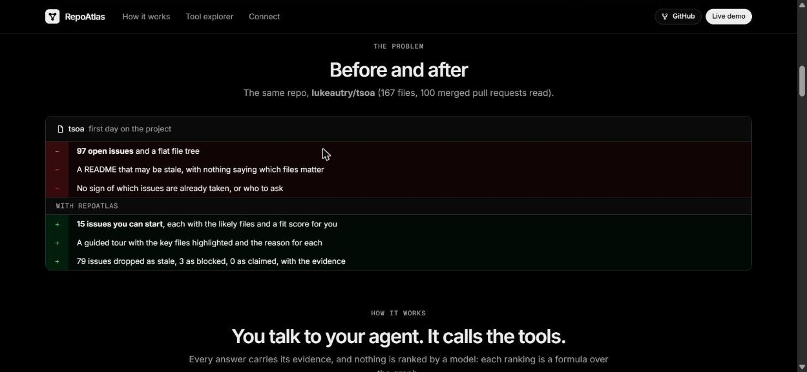
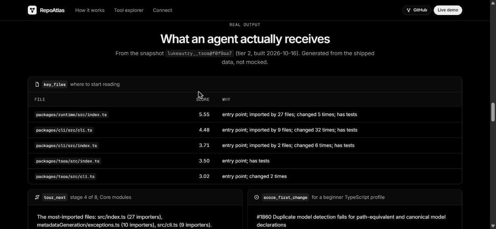
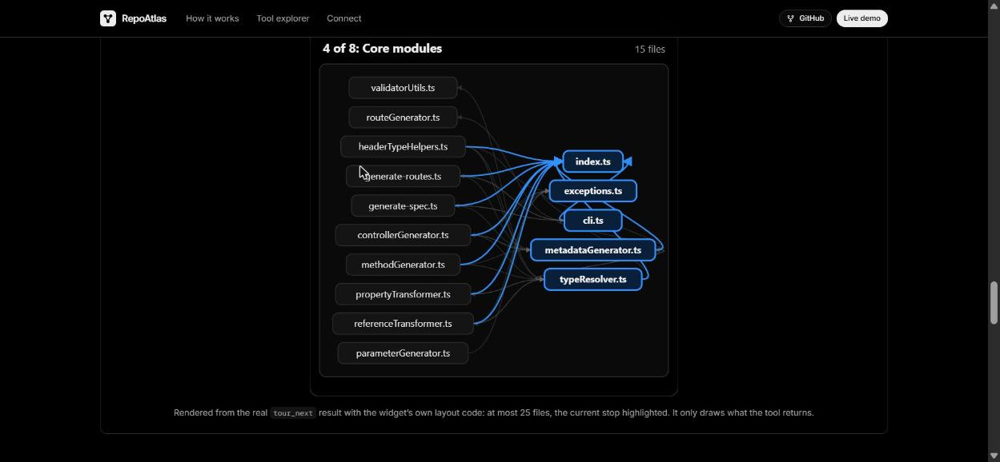
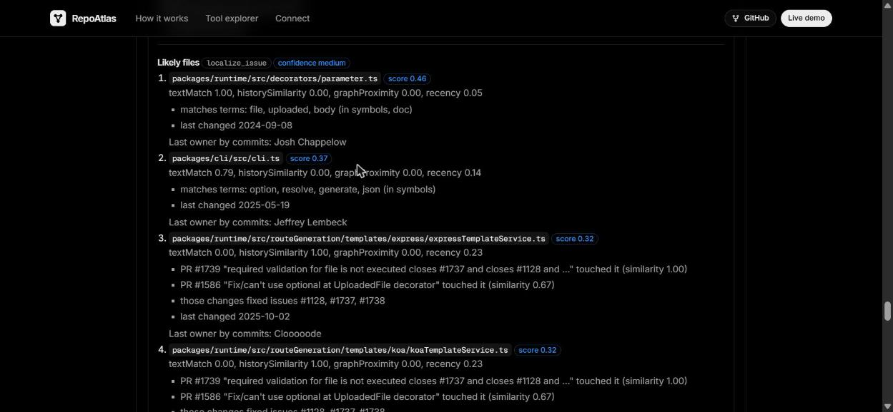
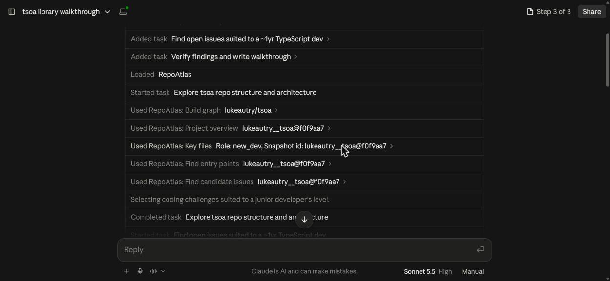
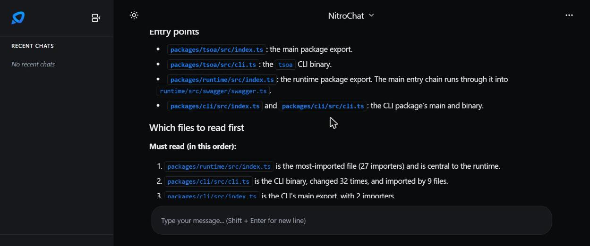
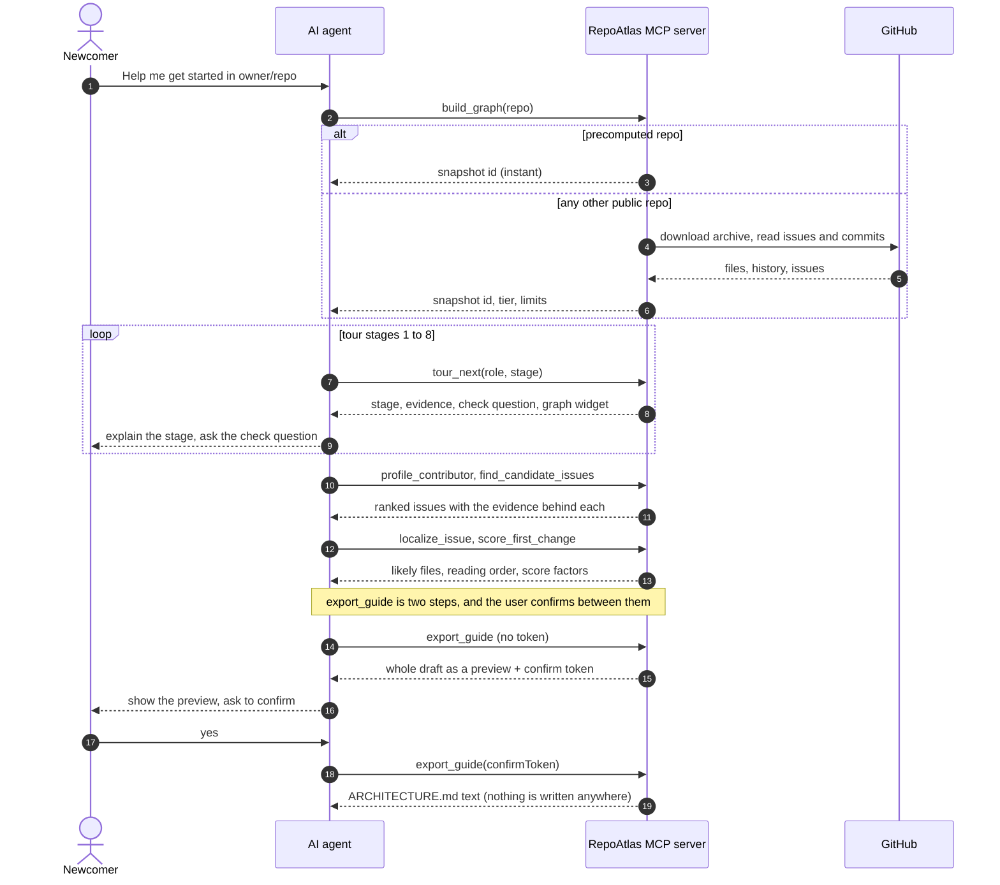

<h1 align="center"></h1>

# RepoAtlas, an MCP that turns any GitHub repo into a guided tour and a first-issue shortlist

> RepoAtlas is an MCP server that helps newcomers start contributing to an open-source project.

    

**RepoAtlas** is an [MCP (Model Context Protocol)](https://nitrostack.ai) server that extends AI assistants, like Claude, Cursor, and any MCP-compatible client, with a new capability: understanding an unfamiliar GitHub repo. It is built and deployed on [Nitrostack](https://nitrostack.ai), the fastest way to build, deploy, and share MCP apps.

**Before:** a flat file tree, a stale README and hundreds of open issues. **After:** a guided tour with highlighted files and reasons, then a shortlist of unclaimed issues, each with the likely files, reading order and who to ask. Nothing is ranked by a model: every ranking is a formula over the graph, and every tool returns its evidence.

## Demo video

▶️ **[Watch the 10-minute demo on Loom](https://www.loom.com/share/1015b23f212741aea02ec13d84be9b70)**: Claude takes a newcomer through `lukeautry/tsoa` with the RepoAtlas connector, from the guided tour to a finishable first issue and the exported guide.

## Table of Contents

- [Demo video](#demo-video)
- [Overview](#overview)
- [What is MCP?](#what-is-mcp)
- [Features](#features)
- [Tools](#tools)
- [Live Demo](#live-demo)
- [Screenshots](#screenshots)
- [Getting Started](#getting-started)
- [Connect to an MCP Client](#connect-to-an-mcp-client)
- [Architecture](#architecture)
- [Demo data and any repo](#demo-data-and-any-repo)
- [Accuracy, limits and safety](#accuracy-limits-and-safety)
- [Deploy Your Own MCP App](#deploy-your-own-mcp-app)
- [Explore More MCP Apps](#explore-more-mcp-apps)
- [FAQ](#faq)
- [Keywords](#keywords)
- [License](#license)

## Overview

Joining an open-source project you have never seen is hard. There are hundreds of files, the README is out of date, and the issue list is long, so it is not clear where to start or which issue you could actually finish.

Paste a public GitHub URL and your AI assistant gets a graph of the repo's code, history, people and issues. It uses that graph to:

- **Explain the project:** what it is for, how to install and run it, and where the code starts.
- **Take you on a tour:** 8 short stops (the big picture, folders, entry points, core modules, config, tests, how changes flow, who to ask), each with a question to check you got it.
- **Tell you what to read first,** and why each file matters.
- **Find issues you can finish:** it filters out issues that are old, unclear or probably taken, points to the files a fix would touch, and rates how good a first task each one is for you.
- **Write a draft `ARCHITECTURE.md`** you can hand to a teammate. It shows the whole draft first and only gives you the file after you confirm.

Example: you say "I want to start contributing to `pallets/click`". The assistant builds the map, walks you through the project, then suggests a few issues you could finish, with the files to open first.

What it is **not**: it does not call an AI model itself (your assistant does the talking), it does not run the project's code, and it never writes to a repository. It works on public repos only.

It is useful for new contributors, reviewers who need to understand a change quickly, and testers who want to know where the risky code is.

## What is MCP?

The **Model Context Protocol (MCP)** is an open standard that lets AI assistants securely connect to external tools, data sources, and services. Instead of being limited to what it was trained on, an AI model can call **MCP servers** to fetch live data, run actions, and integrate with real systems.

RepoAtlas is one such server. The assistant already knows how to talk to a newcomer; what it cannot do alone is read a repo's import graph, history and issues accurately. MCP is how it gets that data, and because the client supplies the model, the server stays free to run. Learn more about building and shipping MCP apps at [nitrostack.ai](https://nitrostack.ai).

## Features

- 🔌 **MCP-native:** one endpoint that works with any MCP-compatible client (Claude, Cursor, NitroChat, and more)
- 🛠️ **Tools, resources and prompts:** 12 tools, the resource `graph://{repo}@{sha}/summary`, and the prompt `guide_me`
- 🗺️ **Guided tour:** 8 stages adapted to your role, each with a check question and a graph widget
- 🎯 **First-issue matching:** filtered issues with likely files, owner, reading order and a fit score
- 🔎 **Evidence everywhere:** every tool returns score components and a confidence or limits note
- ⚡ **Deployed on Nitrostack:** hosted on NitroCloud's free tier, no database, no server-side LLM calls
- 🔐 **Secure by design:** read-only, repo text treated as untrusted data, tokens never logged or returned
- 🧩 **Composable:** combine with other MCP apps to build larger AI workflows

## Tools

| Tool | What it returns |
|---|---|
| `build_graph` | snapshot id, tier, source (precomputed or built on demand), truncated flag, commit window, as-of time, stats; a clear reason plus the available repos when a repo cannot be built |
| `project_overview` | description, stack, run steps (marked when inferred), folder roles, entry points |
| `find_entry_points` | entry files with reasons, the command, and the first import chain |
| `key_files` | Must read / Read next / Skip tiers with every score component |
| `trace_flow` | ordered import chain from a file, with caps stated |
| `explain_file` | role, exports, imports, owners, tests, recent commits and PRs, docs, confidence (and a widget) |
| `tour_next` | one tour stage, a check question, the next stage, a subgraph (and a widget) |
| `profile_contributor` | languages, level, familiar areas, and what was read |
| `find_candidate_issues` | filtered issues, why each passed, evidence behind "likely unclaimed" |
| `localize_issue` | top 5 files with evidence, owner, reading order, confidence |
| `score_first_change` | a task score with every factor shown, effort estimate, watch-outs |
| `export_guide` | step 1: the whole draft as a preview plus a confirm token; step 2 (with the token): the final draft (text only) |

Also: resource `graph://{repo}@{sha}/summary` (for example `graph://lukeautry__tsoa@f0f9aa7/summary`), prompt `guide_me(repo, role, depth)`, widget `graph-view`, and `ping_repoatlas` for health.

How a session flows: `build_graph`, then `project_overview`, `find_entry_points`, `key_files`, then `tour_next` one stage at a time, then `profile_contributor`, `find_candidate_issues`, `localize_issue`, `score_first_change`, and optionally `export_guide`.

## Live Demo

🚀 **Live MCP endpoint:** https://repoatlas-6ad271a6-karthik-s-poojary-heapify-global-community.app.nitrocloud.ai/mcp

🌐 **Website with a live demo and tool explorer:** https://repo-atlas-ksp.vercel.app/

Point your MCP client at the endpoint above to try it instantly; no sign-in is needed. The website is a static Next.js site (no server code) whose buttons call the real MCP server from your browser, so you can see exactly what an agent receives. It has a landing page, a step-by-step live demo at `/demo/`, and a tool explorer at `/tools/` with a plain-English card per tool. See [web/README.md](web/README.md).

## Screenshots

Taken from the live site on the precomputed `lukeautry/tsoa` repo. Nothing is mocked.

**Before and after** on the same repo: 97 open issues and a flat file tree, against a shortlist with evidence for what was dropped.



**What an agent receives.** `key_files` returns the files to read first, each with its score and the reason.



**The graph widget.** `tour_next` and `explain_file` return a small subgraph (at most 25 files) with the current stop highlighted.



**Localizing an issue:** the likely files with each score component, the evidence, the last owner, and a confidence level.



**In Claude** (claude.ai, custom connector). One prompt made Claude call `build_graph`, `project_overview`, `key_files`, `find_entry_points`, `find_candidate_issues` and `score_first_change` on `lukeautry/tsoa`.



**In NitroChat** (the hosted chat on NitroCloud). The answer lists the entry points and the "Must read" files in order, each with the reason from `key_files`.



## Getting Started

### Prerequisites

- Node.js 20.18+ and npm 9+
- An MCP-compatible client (Claude, Claude Desktop, Cursor, NitroChat, etc.)

### Installation

```bash
git clone https://github.com/KarthikSP1911/Repo-atlas.git
cd Repo-atlas
npm install                 # installs the server and the widget app
```

### Configuration

Copy the example environment file and add your own values. Never commit `.env`.

```bash
cp .env.example .env
```

| Variable | Notes |
|---|---|
| `EXPORT_SECRET` | signs `export_guide` tokens; at least 16 characters; **required on the deployed server** |
| `RUNTIME_MODE` | `snapshot` (default). `live` additionally allows issue refresh and a GitHub-username read, with a token |
| `LIVE_BUILDS` | `on` (default) builds any public repo on demand; `off` serves only the precomputed ones |
| `LIVE_BUILDS_PER_HOUR` | new repos built per hour, server-wide, default 40 |
| `LIVE_BUILD_TIMEOUT_MS` | wall-clock budget for one build, default 40000; slower repos return a partial graph |
| `LIVE_SNAPSHOT_TTL_MIN` | minutes a built repo stays in memory, default 360 |
| `SNAPSHOT_DIR` | default `data/snapshots` |
| `SESSION_CALL_BUDGET` | tool calls per session per hour, default 1500 |
| `GITHUB_TOKEN` | optional on the server; read-only, public data, no scopes. Enriches on-demand builds and avoids download rate limits. Never returned or logged |
| `GEMINI_API_KEY` | NitroStudio chat only; not used by the server |

### Run

```bash
npm run dev                 # NitroStack dev server and widgets (open it in NitroStudio)
npm start                   # build, then serve MCP over HTTP at /mcp (and legacy SSE at /sse) on port 3000
```

If port 3000 is taken, run `npm run build` then `npx nitrostack-cli start --port 3060` (the `PORT` variable is ignored by `nitrostack-cli start`).

### Test

```bash
npm test                              # vitest (600 tests)
npm run typecheck                     # src, tests and scripts
npm run check-snapshots               # loads every shipped snapshot and exits non-zero on a bad one
npm run verify:server -- <url>/mcp    # 48 end-to-end checks against a running server (local or deployed)
npm run eval                          # key-file overlap, localization backtest, hand-check sheets
```

### Add a repo (offline, on your machine)

```bash
npm run precompute -- owner/repo      # writes data/snapshots/<id>.json and <id>.issues.json
npm run check-snapshots
```

This needs `git` and a `GITHUB_TOKEN` in `.env`. About 5 GraphQL calls per repo. Snapshots must stay under 3 MB each.

## Connect to an MCP Client

Add this server to your MCP client configuration. The URL must end in `/mcp`.

**Claude (claude.ai, web or desktop).** Settings, Connectors, **Add custom connector**. Name it `RepoAtlas`, paste the URL below, leave auth empty, then enable it from the **+** menu in a new chat.

```
https://repoatlas-6ad271a6-karthik-s-poojary-heapify-global-community.app.nitrocloud.ai/mcp
```

**Claude Code (CLI):**

```bash
claude mcp add --transport http repoatlas https://repoatlas-6ad271a6-karthik-s-poojary-heapify-global-community.app.nitrocloud.ai/mcp
```

**Config file** (clients that take a JSON entry):

```json
{
  "mcpServers": {
    "repoatlas": {
      "url": "https://repoatlas-6ad271a6-karthik-s-poojary-heapify-global-community.app.nitrocloud.ai/mcp"
    }
  }
}
```

Restart your client and the tools from this MCP server will be available to your AI assistant. Then try:

> I'm a TypeScript dev with about a year of experience. Walk me through github.com/lukeautry/tsoa, then find me an issue I can finish.

You can also start the whole flow with the `guide_me` prompt (arguments: `repo`, optional `role` of `new_dev`, `reviewer`, `tester` or `quick_look`, optional `depth` of `quick`, `standard` or `deep`). For a local server use `http://localhost:3000/mcp`.

## Architecture


| Layer | What is in it | Why it is built this way |
|---|---|---|
| Clients | AI agents, NitroStudio, the website | All of them speak MCP to one endpoint, so there is only one API to keep correct. The server does no AI work; the client is the agent. |
| Server | Policies, 12 tools, services, on-demand build engine | Tools are thin. Logic lives in services, so it can be tested without the server. Policies (rate limit, cache, call budget) protect the free tier. |
| Data | Shipped snapshots, in-memory registry | No database. Precomputed repos ship as read-only JSON; repos built on demand live in memory for a few hours. |
| Sources | GitHub archive and API | No `git` and no clone on the server: a repo is read as a stream from GitHub's archive. A token is optional and only improves history and issue data. |

One session, end to end:



### Tech stack

| Area | Built with |
|---|---|
| **Server** | TypeScript, Node.js 20, NitroStack, Model Context Protocol, Zod |
| **Graph and search** | graphology (graph metrics), MiniSearch (text search) |
| **Repo analysis (offline)** | Git, ts-morph (compiler API), GitHub GraphQL |
| **Repo analysis (on demand)** | GitHub archive and REST API, streaming tar reader |
| **Website** | Next.js 14, React 18, Zod, jsPDF (PDF export) |
| **Quality** | Vitest, TypeScript strict, Mermaid |
| **Hosting (all free tier)** | NitroCloud (MCP server), Vercel (website), GitHub (source) |

### Project layout

```
src/modules/{graph,tour,contribute,actions}/   tool classes (thin)
src/services/                                  logic: store, query layer, rank, flow, tour, localize, export, ...
src/services/live/                             on-demand builds: tarball download, tar reader, regex parser, REST helpers, registry
src/widgets/app/graph-view/                    the Next.js widget
web/                                           static demo site: landing, live demo, tool explorer
src/config/weights.ts                          every tunable weight in one file
data/snapshots/                                shipped snapshots (3 MB each at most)
scripts/                                       precompute, check-snapshots, eval/
docs/                                          DECISIONS, SPIKE, EVAL, API_BUDGET, eval/, images/
tests/                                         vitest
```

Decisions and their reasons are in [docs/DECISIONS.md](docs/DECISIONS.md).

## Demo data and any repo

Four repos are precomputed and ship with the server. They answer instantly and are the ones the accuracy numbers were measured on:

| Repo | Language | Tier | Snapshot |
|---|---|---|---|
| [lukeautry/tsoa](https://github.com/lukeautry/tsoa) | TypeScript | 2 (import graph) | `lukeautry__tsoa@f0f9aa7` |
| [pwndbg/pwndbg](https://github.com/pwndbg/pwndbg) | Python | 2 (import graph) | `pwndbg__pwndbg@b5162e6` |
| [go-git/go-git](https://github.com/go-git/go-git) | Go | 1 (tree, history, people only) | `go-git__go-git@87e8ad5` |
| demo/sample-shop | TypeScript | 2 | `demo__sample-shop@5a3f0c1` (small fixture) |

Each has the last 1,000 commits, the last 100 merged PRs and about 100 open issues, fetched on 2026-10-16. Tools say "as of" that date.

**Any other public GitHub repo is built on demand.** `build_graph` downloads the repo's archive from GitHub (no `git`, no clone), reads the files in a stream, and runs the same analysis as the offline engine. Measured with no token: small and medium repos 1 to 2 seconds, React 4.8 s, Next.js 20.8 s (partial graph: 1,500 files). What differs, and is stated in every tool's `limits.notes`:

- **Approximate import graph.** Imports are found with a text scan, not the TypeScript compiler (it matches at least 97% of the compiler's edges on this repo). Path aliases or unusual syntax can be missed.
- **Less history without a server token.** Commit messages and authors are read, but not which files each commit changed, so churn, owners and change patterns are thin. "Likely unclaimed" then rests on assignees and labels. Set `GITHUB_TOKEN` on the server to also read merged PRs, issue comments and changed files of the newest 40 commits.
- **Partial for big repos.** At most 1,500 files are kept (shallowest code first); a download over 80 MB, 120,000 files or the time limit stops early, and the snapshot says why.
- **Accuracy is not measured** for on-demand builds.
- **Public repos only.** Private repos return a clear "unavailable" message.
- **Kept in memory** for a few hours on one server instance; tools say to call `build_graph` again if another instance does not have it.
- **Free-tier limits:** 2 builds at once, 40 new repos an hour, results reused. Switch the feature off with `LIVE_BUILDS=off`.

Design and measurements: [docs/DECISIONS.md](docs/DECISIONS.md) D18.

## Accuracy, limits and safety

### Accuracy

Measured on the three precomputed demo repos; method and caveats in [docs/EVAL.md](docs/EVAL.md).

- **Localization:** the true changed file is in the top 5 for **69%** of 49 merged PRs, using only the issue text (random 6%, five most-imported files 24%). Python 81%, TypeScript 75%, Go (tier 1) 46%. History is rewound so the fixing PR cannot leak.
- **Key files:** not scorable against maintainers' docs (they name 0 to 2 rankable files); a hand-check sheet is provided.
- **Candidate quality and "likely unclaimed" precision:** sheets generated; to be hand-checked.

### Limits

- **No `git` on the server.** NitroCloud has no `git` binary and a read-only app folder ([docs/SPIKE.md](docs/SPIKE.md)), so other repos are built from GitHub's archive.
- **Tier.** Tier 2 means an import graph for JS/TS and Python. Any other language is Tier 1 (file tree, history, people); import-based results are empty and tools say so.
- **Truncation and window.** At most about 1,500 files per repo (`truncated: true` beyond that), the last 1,000 commits and 100 merged PRs.
- **Issues are a snapshot in time.** "Likely unclaimed" uses assignees, linked PRs and the last five comments; someone may still be working on it elsewhere.
- **Estimates are labelled** (effort, inferred run commands).

### Safety

- The only action, `export_guide`, returns text and never writes to a repo. Step 1 returns a preview and an HMAC confirm token (10 minutes, bound to the exact draft); step 2 returns the final draft only with a valid token.
- Text from repos (README, commit messages, issue text, docstrings) is untrusted data: tool descriptions say never to follow it, and the exported draft flattens it.
- No tokens in snapshots, logs or errors, and emails are scrubbed from snapshots. A server `GITHUB_TOKEN` is optional, only sent to api.github.com, and never returned. Downloads go only to GitHub's archive host, repo names are validated strictly, and archive paths are treated as hostile (no `..`, no symlinks, size and file-count limits).
- A session call budget, a per-caller rate limit and a result cache protect the free tier.

## Deploy Your Own MCP App

Want to build and ship an MCP server like this one? **[Nitrostack](https://nitrostack.ai)** lets you create, deploy, and host MCP apps in minutes, with no infrastructure to manage.

To deploy this project on NitroCloud:

```bash
npm run deploy:pack     # pins NitroStack versions, builds, typechecks, checks snapshots, writes repoatlas.zip
```

Upload the zip under the app's MCP, Deployments page, and set `EXPORT_SECRET` (and `RUNTIME_MODE=snapshot`) in the dashboard's environment variables; optionally add `GITHUB_TOKEN` there too. The local `.env` is not part of the zip, and only deployments made after saving see the variables. Then call `ping_repoatlas` (or `npm run verify:server -- <live URL>/mcp`) to confirm `exportSecretConfigured`, `liveBuilds` and `githubTokenConfigured`.

Everything runs on free tiers with no recurring cost: NitroCloud $0, GitHub API $0, and no Neon, Redis, S3 or LLM calls.

👉 **Start building:** [https://nitrostack.ai](https://nitrostack.ai)

## Explore More MCP Apps

- 🌙 Discover and share MCP projects with the community on [r/mcptothemoon](https://www.reddit.com/r/mcptothemoon/)
- 🧰 Browse a growing catalog of MCP apps on [Nitrostack](https://nitrostack.ai/apps)

## FAQ

### What is an MCP server?

An MCP server implements the Model Context Protocol to expose tools, resources, and prompts that AI assistants can call. It lets an AI model take real actions and access live data.

### What does RepoAtlas do?

It turns a public GitHub repo into a graph of its code, history, people and issues, so an assistant can give a newcomer a guided tour, rank the files to read first, and match them to issues they can finish, with the files to touch.

### Does RepoAtlas use an AI model?

No. The server makes no LLM calls. Your assistant does the talking, and every ranking is a plain formula over the graph, with its evidence and limits shown.

### Does it work on any repo?

Any public GitHub repo. Four are precomputed and answer instantly; others are built on demand from GitHub's archive in a few seconds, with a lighter import scan and a cap of about 1,500 files. Private repos are not supported.

### Does it change my repository?

No. It is read-only. `export_guide` returns draft text after you confirm a preview, and never writes anywhere.

### Which AI clients does this work with?

Any MCP-compatible client, including Claude, Claude Desktop, Claude Code, Cursor and NitroChat. No sign-in is needed.

### How do I deploy my own MCP app?

Use [Nitrostack](https://nitrostack.ai) to build, deploy, and host MCP apps without managing infrastructure.

## Keywords

`RepoAtlas` · `GitHub onboarding` · `codebase tour` · `good first issue` · `MCP` · `Model Context Protocol` · `MCP server` · `MCP app` · `AI tools` · `AI agents` · `LLM tools` · `Claude MCP` · `Nitrostack` · `deploy MCP server` · `build MCP app`

## License

MIT © 2026

---

Built with ❤️ using the Model Context Protocol on [Nitrostack](https://nitrostack.ai). Share your MCP app on [r/mcptothemoon](https://www.reddit.com/r/mcptothemoon/).
