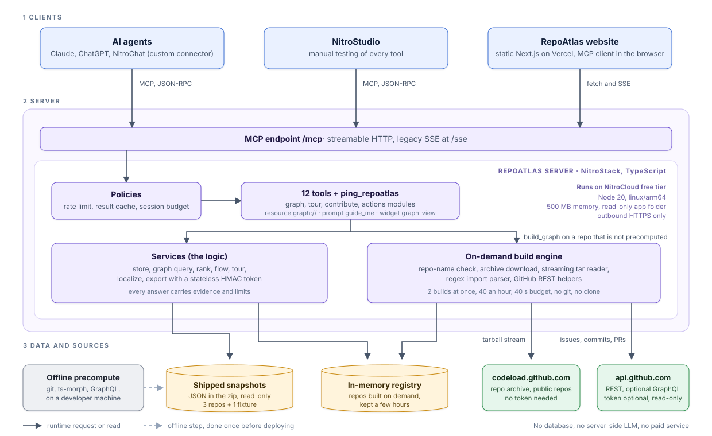
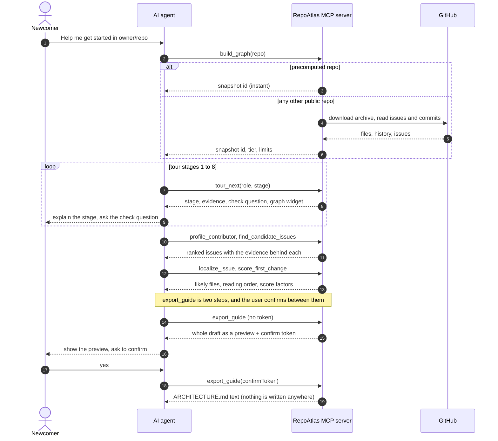

<h1 align="center"></h1>

<p align="center">
  
  
  
  
  <!--  -->
</p>

An MCP server that turns any public GitHub repo (paste its URL) into a graph of its code, history, people and issues, so an AI agent can walk a newcomer through the project step by step and then find the issues they can actually finish, with the files to touch.

Built on [NitroStack](https://docs.nitrostack.ai) (TypeScript), deployed to NitroCloud's free tier. Track: Developer Tools. Original product: GitHub (learning an unfamiliar repo, and choosing a first issue).

**Before:** a flat file tree, a stale README and hundreds of open issues. **After:** a guided tour with highlighted files and reasons, then a shortlist of unclaimed issues, each with the likely files, reading order and who to ask. Nothing is ranked by a model: every ranking is a formula over the graph, and every tool returns its evidence.

## What this project does, in plain words

Joining an open-source project you have never seen is hard. There are hundreds of files, the README is out of date, and the issue list is long, so it is not clear where to start or which issue you could actually finish.

RepoAtlas is a helper that an AI assistant (such as Claude or ChatGPT) can plug into. You give it a GitHub link. It reads the project (the files, which files use which, the history, who works on what, and the open issues) and builds a map from that. Your assistant then uses the map to:

- **Explain the project:** what it is for, how to install and run it, and where the code starts.
- **Take you on a tour:** 8 short stops (the big picture, folders, entry points, core modules, config, tests, how changes flow, who to ask), each with a question to check you got it.
- **Tell you what to read first,** and why each file matters.
- **Find issues you can finish:** it filters out issues that are old, unclear or probably taken, points to the files a fix would touch, and rates how good a first task each one is for you.
- **Write a draft `ARCHITECTURE.md`** you can hand to a teammate. It shows you the whole draft first and only gives you the file after you confirm. You can download it as Markdown or PDF.

Example: you say "I want to start contributing to `pallets/click`". The assistant builds the map, walks you through the project, and then suggests a few issues you could finish, with the files to open first.

What it is **not**: it does not call an AI model itself (your assistant does the talking), it does not run the project's code, and it never writes to a repository. It works on public repos only. Its rankings are plain formulas over the map, and every answer shows the evidence and the limits behind it, so you can check it.

It is useful for new contributors, reviewers who need to understand a change quickly, and testers who want to know where the risky code is.

## Try it without setting anything up

The `web/` folder is a static Next.js site (no server code) with:

- a landing page with a box to paste any public GitHub URL;
- a **live demo** at `/demo/`: buttons that call the real MCP server from your browser, step by step (pick a repo or paste a URL, understand it, take the tour, find issues, localize and score one, preview and confirm an export);
- a **tool explorer** at `/tools/` that runs any single tool, including the graph widget drawn by `tour_next` and `explain_file`. Every tool has a plain-English card: what it does, what to enter (required or optional, with an example and help text), what you get back, and how to read it. Inputs are checked with zod before anything is sent, and results are laid out as tables, chips and cards that never overflow.

Both show exactly what an agent would receive. No AI model is involved. The site is drawn at 80% scale on wide screens (reset browser zoom to 100%). Run it with `cd web && npm install && npm run dev` (http://localhost:3100), or deploy the `web` folder to Vercel; see [web/README.md](web/README.md).

**Exporting the guide:** `export_guide` is two buttons, "Step 1: Preview the guide" and "Step 2: Get the full draft". The preview shows the whole draft as formatted text; after Step 2 you can **Download .md**, **Download PDF** or copy the Markdown. The PDF is made in your browser (nothing is uploaded) and has a title band, summary, tables and page numbers.

## What it does

1. `build_graph` takes a repo (`owner/repo` or a GitHub URL) and returns a snapshot (commit, tier, as-of time): instantly for the four precomputed repos, and built on demand from GitHub's archive for any other public repo (a few seconds, up to about 40 for a huge one).
2. `project_overview`, `find_entry_points`, `key_files` give purpose, stack, run steps, folder roles, where execution starts and the files to read first.
3. `tour_next` walks 8 stages (orient, layout, entry points, core modules, config, tests, change patterns, people) one at a time, adapted to the role (new developer, reviewer, tester, quick look), with a check question per stage and a small import graph drawn by a widget.
4. `profile_contributor` and `find_candidate_issues` filter open issues to ones that are open, likely unclaimed, recent and clear.
5. `localize_issue` finds the files an issue would change; `score_first_change` scores how good a first change it is for this person.
6. `export_guide` drafts an `ARCHITECTURE.md` (an at-a-glance summary, run steps, folder layout, entry points, core modules, tests, change patterns, owners and key files to read first), only after the user confirms a preview.

## Tools

| Tool | What it returns |
|---|---|
| `build_graph` | snapshot id, tier, source (precomputed or built on demand), truncated flag, commit window, as-of time, stats; a clear reason plus the available repos when a repo cannot be built |
| `project_overview` | description, stack, run steps (marked when inferred), folder roles, entry points |
| `find_entry_points` | entry files with reasons, the command, and the first import chain |
| `key_files` | Must read / Read next / Skip tiers with every score component |
| `trace_flow` | ordered import chain from a file, with caps stated |
| `explain_file` | role, exports, imports, owners, tests, recent commits and PRs, docs, confidence (and a widget) |
| `tour_next` | one tour stage, a check question, the next stage, a subgraph (and a widget) |
| `profile_contributor` | languages, level, familiar areas, and what was read |
| `find_candidate_issues` | filtered issues, why each passed, evidence behind "likely unclaimed" |
| `localize_issue` | top 5 files with evidence, owner, reading order, confidence |
| `score_first_change` | a task score with every factor shown, effort estimate, watch-outs |
| `export_guide` | step 1: the whole draft as a preview plus a confirm token; step 2 (with the token): the final draft (text only) |

Also: resource `graph://{repo}@{sha}/summary` (for example `graph://lukeautry__tsoa@f0f9aa7/summary`), prompt `guide_me(repo, role, depth)`, widget `graph-view`, and `ping_repoatlas` for health.

## Architecture (high-level design)



How the pieces fit:

| Layer | What is in it | Why it is built this way |
|---|---|---|
| Clients | AI agents, NitroStudio, the website | All of them speak MCP to one endpoint, so there is only one API to keep correct. The server does no AI work; the client is the agent. |
| Server | Policies, 12 tools, services, on-demand build engine | Tools are thin. Logic lives in services, so it can be tested without the server. Policies (rate limit, cache, call budget) protect the free tier. |
| Data | Shipped snapshots, in-memory registry | No database. Precomputed repos ship as read-only JSON; repos built on demand live in memory for a few hours. |
| Sources | GitHub archive and API | No `git` and no clone on the server: a repo is read as a stream from GitHub's archive. A token is optional and only improves history and issue data. |

One session, end to end (the numbers are the order of the calls):



## Tech stack

| Area | Built with |
|---|---|
| **Server** |      |
| **Graph and search** |   |
| **Repo analysis (offline)** |    |
| **Repo analysis (on demand)** |   |
| **Website** |     |
| **Quality** |    |
| **Hosting (all free tier)** |    |

## Demo data

Four repos are precomputed and ship with the server. They answer instantly and are the ones the accuracy numbers below were measured on. **Any other public GitHub repo is built on demand** (see "Any repo" below):

| Repo | Language | Tier | Snapshot |
|---|---|---|---|
| [lukeautry/tsoa](https://github.com/lukeautry/tsoa) | TypeScript | 2 (import graph) | `lukeautry__tsoa@f0f9aa7` |
| [pwndbg/pwndbg](https://github.com/pwndbg/pwndbg) | Python | 2 (import graph) | `pwndbg__pwndbg@b5162e6` |
| [go-git/go-git](https://github.com/go-git/go-git) | Go | 1 (tree, history, people only) | `go-git__go-git@87e8ad5` |
| demo/sample-shop | TypeScript | 2 | `demo__sample-shop@5a3f0c1` (small fixture) |

Each has the last 1,000 commits, the last 100 merged PRs and about 100 open issues, fetched on 2026-10-16. Tools say "as of" that date.

## Any repo (built on demand)

`build_graph` accepts any public GitHub repo. If it is not precomputed, the server downloads the repo's archive from GitHub (no `git`, no clone), reads the files in a stream, and runs the same analysis and snapshot code as the offline engine. Measured with no token on this machine: small and medium repos 1 to 2 seconds, React 4.8 s, Next.js 20.8 s (partial graph: 1,500 files).

What is different from a precomputed repo, and said in every tool's `limits.notes`:
- **Approximate import graph.** Imports are found with a text scan, not the TypeScript compiler (on this repo it matches at least 97% of the compiler's edges). Path aliases or unusual syntax can be missed.
- **Less history without a server token.** Commit messages and authors are read, but not which files each commit changed, so churn, owners and change patterns are thin. Issues come without comments or linked PRs, so "likely unclaimed" rests on assignees and labels. Set `GITHUB_TOKEN` on the server (read-only, no scopes) and it also reads merged PRs, issue comments and the changed files of the newest 40 commits.
- **Partial for big repos.** At most 1,500 files are kept (shallowest code first), and a download over 80 MB, 120,000 files or the time limit stops early; the snapshot says why.
- **Accuracy is not measured** for on-demand builds. The 69% below is for the precomputed repos.
- **Public repos only.** Private repos, and repos GitHub refuses to serve, return a clear "unavailable" message.
- **Kept in memory** for a few hours on one server instance. If another instance does not have it, tools say to call `build_graph` again.
- **Free-tier limits:** 2 builds at once, 40 new repos an hour, results reused. GitHub also rate-limits anonymous downloads per network address (HTTP 429); a server token avoids that. Switch the whole feature off with `LIVE_BUILDS=off`.

Design and measurements: [docs/DECISIONS.md](docs/DECISIONS.md) D18.

## Accuracy

Measured on the three precomputed demo repos; details, method and caveats in [docs/EVAL.md](docs/EVAL.md).

- **Localization:** the true changed file is in the top 5 for **69%** of 49 merged PRs, using only the issue text (random 6%, fan-in baseline 24%). Python 81%, TypeScript 75%, Go (tier 1) 46%. History is rewound so the fixing PR cannot leak.
- **Key files:** not scorable against maintainers' docs (they name 0 to 2 rankable files); a hand-check sheet is provided.
- **Candidate quality and "likely unclaimed" precision:** sheets generated; to be hand-checked.
- **API use (precomputed repos):** 5 to 6 GitHub GraphQL calls per repo build (17 for all three), made offline; zero at runtime. On-demand builds make about 4 REST calls per repo without a token (about 50 with one) and one archive download.

## Limits

- **No `git` on the server.** NitroCloud has no `git` binary and a read-only app folder ([docs/SPIKE.md](docs/SPIKE.md)), so repos that are not precomputed are built from GitHub's archive instead of a clone (see "Any repo" above for what that changes).
- **Tier.** Tier 2 means an import graph for JS/TS and Python. Any other language is Tier 1 (file tree, history, people); import-based results are empty and tools say so.
- **Truncation and window.** At most about 1,500 files per repo (over that: a partial graph with `truncated: true`), the last 1,000 commits and 100 merged PRs.
- **Issues are a snapshot in time.** "Likely unclaimed" uses assignees, linked PRs and the last five comments; someone may still be working on it elsewhere.
- **Estimates are labelled** (effort, inferred run commands).

## Safety

- The only action, `export_guide`, returns text and never writes to a repo. Step 1 returns the draft as a preview and an HMAC confirm token (10 minutes, bound to the exact draft, stateless); step 2 returns the final draft only with a valid token and refuses otherwise. The website hides the token and drives both steps with buttons.
- Text from repos (README, commit messages, issue text, docstrings) is untrusted data: tool descriptions say never to follow it, and the exported draft flattens it (no links, HTML or headings from repo text).
- No tokens in snapshots, logs or errors. Emails are scrubbed from snapshots and issue files. A server `GITHUB_TOKEN` is optional, is only sent to api.github.com (never forwarded on a redirect), and is never returned: tests search every output for it. Downloads go only to GitHub's archive host, repo names are validated strictly, and archive paths are treated as hostile (no `..`, no symlinks, size and file-count limits).
- A session call budget, a per-caller rate limit and a result cache protect the free tier.

## Run it

Needs Node 20.18+ and npm 9+.

```bash
npm install                 # installs the server and the widget app
npm run dev                 # NitroStack dev server and widgets (open it in NitroStudio)
npm run build               # widgets + TypeScript to dist/
npm test                    # vitest (600 tests)
npm run typecheck           # src, tests and scripts
npm run check-snapshots     # loads every shipped snapshot and exits non-zero on a bad one
npm run verify:server -- <url>/mcp   # 48 end-to-end checks against a running server (local or deployed)
```

Production start (`npm start`) serves MCP over HTTP at `/mcp` (streamable HTTP, and legacy SSE at `/sse`) on port 3000. If 3000 is taken, run `npm run build` then `npx nitrostack-cli start --port 3060`, and paste `http://localhost:3060/mcp` into the website's server box (the `PORT` variable is ignored by `nitrostack-cli start`).

### Configuration

Copy `.env.example` to `.env`. Never commit it.

| Variable | Used by | Notes |
|---|---|---|
| `EXPORT_SECRET` | server | signs `export_guide` tokens; at least 16 characters; **required on the deployed server** |
| `RUNTIME_MODE` | server | `snapshot` (default). `live` additionally allows issue refresh and a GitHub-username read, with a token. Not related to on-demand repo builds |
| `LIVE_BUILDS` | server | `on` (default) builds any public repo on demand; `off` serves only the precomputed ones |
| `LIVE_BUILDS_PER_HOUR` | server | new repos built per hour, server-wide, default 40 |
| `LIVE_BUILD_TIMEOUT_MS` | server | wall-clock budget for one build, default 40000; slower repos return a partial graph |
| `LIVE_SNAPSHOT_TTL_MIN` | server | minutes a built repo stays in memory, default 360 |
| `SNAPSHOT_DIR` | server | default `data/snapshots` |
| `SESSION_CALL_BUDGET` | server | tool calls per session per hour, default 1500 |
| `GITHUB_TOKEN` | offline scripts; optional on the server | read-only, public data, no scopes. On the server it enriches on-demand builds (PRs, issue comments, per-commit files) and avoids download rate limits; `ping_repoatlas` reports only whether it is set |
| `GEMINI_API_KEY` | NitroStudio chat only | not used by the server |

### Add a repo (offline, on your machine)

```bash
npm run precompute -- owner/repo      # writes data/snapshots/<id>.json and <id>.issues.json
npm run check-snapshots
```

This needs `git` and a `GITHUB_TOKEN` in `.env`. About 5 GraphQL calls per repo. Snapshots must stay under 3 MB each.

### Evaluate

```bash
npm run eval                # key-file overlap, localization backtest, hand-check sheets
```

## Deploy (NitroCloud)

```bash
npm run deploy:pack     # pins NitroStack versions, builds, typechecks, checks snapshots, writes repoatlas.zip
```

Upload the zip under the app's MCP, Deployments page, and set `EXPORT_SECRET` (and `RUNTIME_MODE=snapshot`) in the dashboard's environment variables there. Optionally add `GITHUB_TOKEN` there too (see the configuration table). The local `.env` is not part of the zip, so every variable must be set in the dashboard, and only deployments made after saving see it. Then call `ping_repoatlas` (or `npm run verify:server -- <live URL>/mcp`) to confirm `exportSecretConfigured`, `liveBuilds` and `githubTokenConfigured`. The MCP endpoint is `<live URL>/mcp`; connect it to Claude or ChatGPT as a custom connector, or use NitroChat.

Live URL: `https://repoatlas-6ad271a6-karthik-s-poojary-heapify-global-community.app.nitrocloud.ai/mcp`

### Cost

Everything runs on free tiers; no recurring cost.

| Item | Cost |
|---|---|
| NitroCloud (free tier) | $0 |
| GitHub API (about 17 GraphQL calls for the demo data, offline; REST calls for on-demand builds) | $0 |
| Neon, Redis, S3, LLM calls | none used |

## Project layout

```
src/modules/{graph,tour,contribute,actions}/   tool classes (thin)
src/services/                                  logic: store, query layer, rank, flow, tour, localize, export, ...
src/services/{ingest,parse,link,graph,build}.service.ts   offline engine (git and ts-morph; not loaded by the server)
src/services/{parse.common,ingest.common,people,github.fetch,assemble}.ts   pure parts shared by both engines
src/services/live/                             on-demand builds: tarball download, tar reader, regex parser, REST helpers, registry
src/widgets/app/graph-view/                    the Next.js widget
web/                                           static demo site: landing, live demo, tool explorer (see web/README.md)
src/config/weights.ts                          every tunable weight in one file
data/snapshots/                                shipped snapshots (3 MB each at most)
scripts/                                       precompute, check-snapshots, eval/
docs/                                          DECISIONS, SPIKE, EVAL, API_BUDGET, eval/, images/ (HLD diagram, logo banner)
tests/                                         vitest
```

Decisions and their reasons are in [docs/DECISIONS.md](docs/DECISIONS.md).
